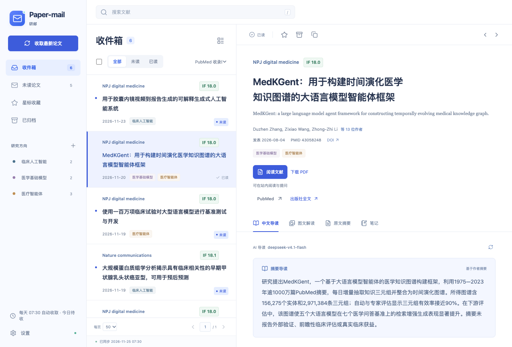

# 研邮 · Paper-mail

**像查邮件一样，查 PubMed 新论文。**

研邮是一个在自己电脑上运行的 PubMed 文献收件箱，适合需要持续跟进专科研究的临床医生、研究生和生物医学研究者。设好关注的课题和期刊，每天打开收件箱就能看有哪些新论文。

- **用一句话订阅课题。** 写下你想追踪的问题，研邮生成 PubMed 检索式，并显示 PubMed 实际查到多少篇。检索式可以查看、修改和重新验证。
- **按你的标准收论文。** 可以指定期刊、设置影响因子门槛，也可以让模型按标题和摘要复核相关性。同一篇论文命中多个方向时，只收一次，保留对应的方向标签。
- **先补近期文献，再每天收新。** 选一段日期建立收件箱，之后按设定时间检查 PubMed 新收录的论文。看到值得回看的文章就加星标，读完可归档。
- **从中文导读读到全文。** 先看中文题名、主要结果和研究局限，再对照作者摘要或主图。有可用的 PDF 时，能在同一个阅读器里看全文、问 AI，并保留本篇对话。

[安装与启动](#安装与启动) · [添加自己的订阅](#添加自己的订阅) · [阅读论文](#阅读论文)

[](docs/images/paper-mail-inbox.webp)

## 安装与启动

首次安装需要 **Node.js 22.13+** 和 **Python 3.11+**。macOS 可通过官网安装包安装。[Node.js 下载](https://nodejs.org/en/download) · [Python 下载](https://www.python.org/downloads/macos/)

**macOS 后台启动。** 将项目放在 `~/Applications/paper-mail`，双击 `启动Paper-mail.command`。脚本会安装锁定的 npm 依赖、创建 Python 虚拟环境、构建网页，确认后台服务响应后打开收件箱。缺少运行时，脚本会打开对应的官方下载页。登录时服务自动启动，关闭浏览器后仍会收取论文。双击 `停止后台服务.command` 可取消登录启动。

```sh
mkdir -p ~/Applications
git clone https://github.com/caid6/paper-mail.git ~/Applications/paper-mail
cd ~/Applications/paper-mail
./启动Paper-mail.command
```

**已安装的 macOS 用户。** 在原安装目录运行 `git pull --ff-only`，再运行 `./启动Paper-mail.command`。如果准备迁移安装位置，先在原目录运行 `./停止后台服务.command`，再移动整个目录，并在新目录启动。迁移时请一并保留 `data/` 和本机的 `.env`。从桌面、文稿或下载目录启动后台服务可能遇到 macOS 文件访问限制。[Apple 文件访问说明](https://support.apple.com/guide/security/controlling-app-access-to-files-secddd1d86a6/web)

**手动启动。** 在克隆的项目目录执行以下命令，然后打开浏览器。定时收取需要进程持续运行。[打开本机收件箱](http://127.0.0.1:4317)

```sh
npm ci
npm run setup:python
npm run build
npm start
```

研邮预置医学人工智能、医学基础模型和医疗智能体三个方向。**第一次打开，点左侧的「收取最新论文」**，可以直接收取 PubMed 论文并查看原文摘要。默认期刊门槛为 **IF ≥ 10**，可在 **设置 → 文献筛选** 调整或关闭。

## 添加自己的订阅

1. **接入模型。** 打开 **设置 → API 与模型**，选择 OpenAI 兼容接口或 Google Gemini，填写服务基础地址和自己的 API Key。用 **读取模型列表** 选择文字和图文模型，也可手动填写模型 ID。点 **验证并保存**，通过后就能使用检索方案生成、中文导读等功能。
2. **描述你的课题。** 点击侧栏 **研究方向** 旁的加号，可以直接试试这句话。
   > 我想追踪大语言模型在结直肠癌筛查和诊断中的应用，重点关注有临床数据验证的研究。

   点 **生成检索方案**，检查检索范围和全库匹配篇数，再点 **保存研究方向**。如果修改了检索式，先点 **验证检索式**。只想追踪新方向时，可以在方向设置里暂停预置方向。
3. **建立第一批收件箱。** 在 **设置 → 文献筛选** 设置影响因子，也可以输入「医学四大刊和胃肠领域顶刊」，点 **生成期刊清单** 后增删刊名。两项都开启时，论文须同时符合。到下方 **初始化文献库** 选择 **最近 1 个月** 或自定义日期，点 **按此范围初始化文献库**。看到「已建库」后回收件箱查看。
4. **设好每天的收取时间。** 在 **设置 → 每日推送** 调整时区和时间。默认每天北京时间 07:30，每个方向检查最新 10 篇。电脑休眠或关机错过当天任务后，服务恢复时会补跑。收取结果可在侧栏和 **最近收信记录** 查看。

建库可按 **PubMed 建档日期** 追踪新入库记录，也可按 **论文发表日期** 回溯。可在同一区域开关 **自动进行相关性质控**。重新建库后，未纳入的论文可在 **已归档 → 移出记录** 查看，原有的已读状态、星标、笔记和 PDF 都保留。

## 阅读论文

- **中文导读。** 收件箱默认按 **PubMed 收录日期** 倒序，每页 50 篇。可切换为 **研邮收信时间** 或 **论文发表日期**，列表显示与排序对应的日期，详情同时显示三种日期。点开论文，看研究问题、核心方法、主要发现和证据局限。打开 **原文摘要** 可以核对作者的表述。
- **图文解读。** 有可用的 PMC 主图、Nature Portfolio 公开主图或带主图图注的本机 PDF 时，研邮可以把图和作者图注放在一起解读。使用 PDF 时，显示含主图的整页，以保留子图和图注。
- **全文问答。** 论文有本机 PDF 时，点 **阅读文献**，一边滚动读全文，一边提问。例如可以问「作者在哪些数据上做了外部验证？」问答使用 PDF 中可提取的文字。按 Enter 发送，按 Shift+Enter 换行。
- **上传 PDF。** 自动获取不可用或失败后，点 **上传 PDF** 添加同一篇论文的文件，最大 50 MB、1000 页。也能从阅读区直接打开 PubMed 或出版社原文。

手动归档的论文会出现在 **已归档**。同一页的 **移出记录** 可以查看建库未纳入、被相关性质控筛除，或旧版未记录归档来源的论文。两个列表都可以把论文移回收件箱。

## 模型、全文和数据

**模型要求。** 基础 PubMed 检索和原文摘要阅读可以直接使用。检索式和期刊清单生成、中文导读、相关性质控、图文解读及全文问答需要配置模型。用于结构化生成的模型须支持 JSON Object 输出，图文模型还须支持图片输入。通过验证的密钥保存在本机的 `.env`。[环境变量示例](.env.example)

**全文准备。** 项目自带公开 PDF 下载器，可查找 PMC、Europe PMC、受支持的出版社公开全文和 OpenAlex 的开放版本。下载后会核对 DOI 或标题。遇到付费、需登录或自动下载未成功的论文，可从出版社打开原文或上传同篇 PDF。机构访问取决于所在机构的授权和本机配置。PDF 有可提取的文字时才支持全文问答，纯扫描件可以阅读。[全文准备与问答实现](DEVELOPMENT.md#站内阅读与问答)

**安装与连接排查。** PDF 功能报环境未就绪时，运行 `npm run setup:python` 后重启服务。默认使用项目的 `.venv`，已有 Python 环境也可以通过本机 `.env` 的 `PAPER_DOWNLOAD_PYTHON` 指定。若 PyPI 不可达，可在终端配置 `PIP_INDEX_URL` 指向可访问的 HTTPS 软件源。PubMed 会分别提示 DNS、网络超时和 HTTP 错误。有代理的环境可配置 `HTTPS_PROXY` 和 `NO_PROXY`。模型设置中的 **测试连接** 会分别检查 JSON 和图像输入，并提示密钥、权限或额度错误。

**数据存放。** 服务只监听 `127.0.0.1`。阅读记录、笔记、问答和文献设置存放在本机 `data/papers.sqlite`，PDF 在 `data/downloads/`，主图在 `data/figures/`。使用模型功能时，对应材料会发送到你设置的模型服务，例如导读所需的标题与摘要、问答所需的 PDF 文字和本篇对话。

**期刊指标。** 采用 2026 年发布的 **2025 JIF** 总表及 10 月修正，优先按 ISSN 匹配。开启影响因子筛选后，只收取并显示有可核验 JIF 且达到门槛的论文。[JCR 发布公告](https://clarivate.com/news/clarivate-releases-journal-citation-reports-2026/) · [官方修正表](https://journalcitationreports.zendesk.com/hc/en-gb/articles/47808147130129-2026)

## 开发与反馈

项目使用 React、TypeScript、Express 和 SQLite。停止本机后台服务后，可用 `npm run dev` 启动开发模式。提交前运行 `npm test` 和 `npm run build`。[开发与交接文档](DEVELOPMENT.md)

欢迎分享你想追踪的课题，或提交收取、期刊匹配和全文阅读中的问题。提交问题时可附上复现步骤、PMID 或脱敏报错。[GitHub Issues](https://github.com/caid6/paper-mail/issues)
